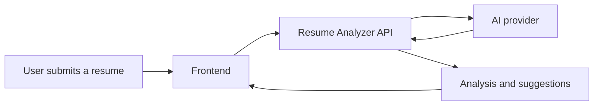

<div align="center">


<p><strong>Analyze your resume. Discover improvements. Apply with confidence.</strong></p>

<p>
  
  
  
</p>

</div>

---

## 📌 About the Project

**ResumePilot AI** is a resume-analysis web application designed to help job seekers review their resumes and identify areas to improve. It aims to provide clear feedback on resume structure, relevant skills, and applicant-tracking-system (ATS) readiness.

> **Important:** AI-powered analysis requires a valid API configuration and available provider credits. A running backend alone does not guarantee that AI analysis will work.

## ✨ Features

- 📄 Resume analysis through a web interface
- 🎯 ATS-focused resume improvement guidance
- 💡 Suggestions to improve resume wording and presentation
- 🌐 Browser-based frontend connected to a backend API
- 🚀 Frontend and backend can be deployed separately

*Update this list to match the features currently implemented in your version.*

## 🖼️ Project Preview

<p align="center">
  
</p>

To show a screenshot of your actual website, upload it to a `screenshots` folder in this repository, then replace the placeholder above with:

```markdown

```

## 🧰 Tech Stack

- **Frontend:** Web application (confirm the framework in your client folder)
- **Backend:** Node.js API
- **AI integration:** External AI API
- **Deployment:** Frontend and backend hosting services

## 🏗️ How It Works



## 📁 Suggested Project Structure

```text
resume-pilot-ai/
├── client/        # Frontend application
├── server/        # Backend API
├── README.md
└── .gitignore
```

Your actual folder names may be different.

## ⚙️ Run Locally

> Check the `package.json` files in your project for the exact scripts and environment variables before running these commands.

### 1. Clone the repository

```bash
git clone https://github.com/YOUR-USERNAME/YOUR-REPOSITORY.git
cd YOUR-REPOSITORY
```

### 2. Start the frontend

```bash
cd client
npm install
npm run dev
```

### 3. Start the backend

Open a second terminal and run the commands appropriate for your backend. For example:

```bash
cd server
npm install
npm start
```

If `npm start` is not defined, use the script listed in `server/package.json`.

### 4. Configure environment variables

Create a backend `.env` file if your code requires one. The names below are examples only; use the exact variable names expected by your application:

```env
AI_API_KEY=your_api_key_here
PORT=10000
```

**Security:** Never commit `.env` files or expose API keys in frontend code, screenshots, logs, or GitHub. Keep `.env` in `.gitignore` and configure production secrets in your hosting dashboard.

## 🌍 Deployment Checklist

1. Deploy the backend API.
2. Set the frontend's API URL to the deployed backend address using the environment variable expected by your code.
3. Allow the production frontend URL in the backend CORS configuration, if applicable.
4. Redeploy the frontend after changing environment variables.
5. Test the health endpoint, then test a complete resume-analysis request.

A successful health-check response means the server is reachable; it does **not** prove that AI credentials or provider credits are available.

## 🛠️ Troubleshooting

| Issue | What to check |
|---|---|
| `Failed to fetch` | Backend status, frontend API URL, network access, and CORS settings. |
| Health check works but analysis fails | AI API key, provider configuration, account billing, and server logs. |
| `429` / no credits remaining | The AI provider account has no available credits. Add credits or use another provider/quota that you are authorized to use. Redeploying alone will not fix exhausted credits. |
| Missing environment variable | Confirm the variable name matches the code and is configured in your hosting dashboard. |
| Resume upload fails | Check supported file types, file-size limits, and backend upload configuration. |

## 🔐 Privacy & Security

- Be careful when uploading resumes containing personal information.
- Understand how your application and AI provider process submitted data.
- Never publish API keys or other secrets.
- Before accepting real users, consider file validation, rate limiting, access controls, and clear data-retention rules.

## 🗺️ Roadmap

- [ ] Replace the preview placeholder with real screenshots
- [ ] Add a short demo GIF
- [ ] Improve loading, success, and error messages
- [ ] Test the complete analysis flow after deployment
- [ ] Document supported file types and analysis criteria

## 👨‍💻 Author

**Atharva Dahibhate**  
BCA Student | Aspiring Software Engineer

- GitHub: [@atharvadahibhate1212](https://github.com/atharvadahibhate1212)
- LinkedIn: [Atharva Dahibhate](https://linkedin.com/in/atharva-dahibhate)

---

<div align="center">
  <sub>Built as a learning project exploring web development and AI-powered resume feedback.</sub>
</div>
